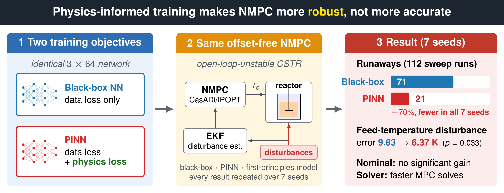
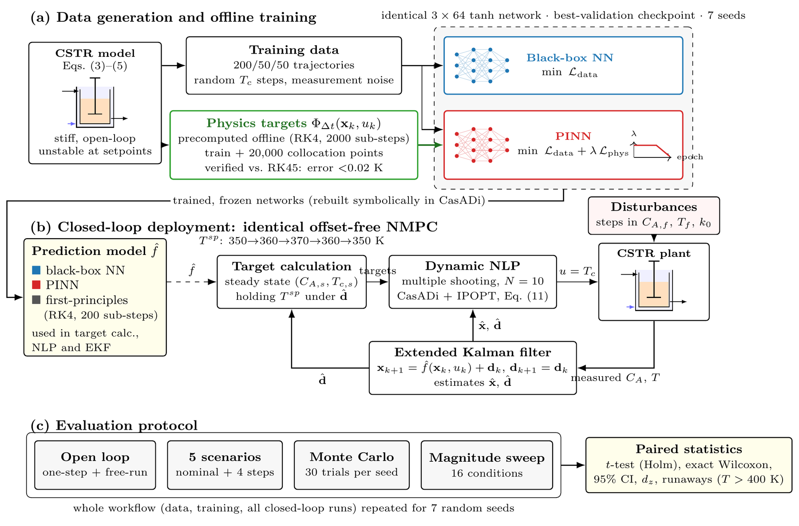

# Physics-Informed vs. Black-Box Neural Networks in Offset-Free NMPC of a CSTR

Code for the study *"Physics-Informed Neural Network Surrogates for Model Predictive Control of a Nonisothermal Continuous Stirred Tank Reactor: A Multi-Seed Evaluation of Nominal Tracking and Robustness"* (manuscript submitted to the *Journal of Process Control*).

A black-box neural network and a physics-informed neural network (PINN) with **identical architecture** are used as prediction models inside the **same offset-free nonlinear MPC** of an open-loop-unstable CSTR, with a first-principles NMPC as reference. The complete workflow (data generation, training, all closed-loop runs) is repeated over **seven random seeds** and compared with paired statistics.

**Main finding:** physics-informed training did **not** significantly improve nominal tracking, but it made the controller much **more robust**. In a 16-condition disturbance sweep, thermal runaway occurred in **21 of 112** PINN-controlled runs versus **71 of 112** black-box runs, with fewer runaways in every seed.



\---

## Key results (7 seeds)

|Scenario|Black-box NN|PINN|First-principles|PINN better (seeds)|p (Holm)|
|-|-|-|-|-|-|
|Nominal, RMSE<sub>T</sub> (K)|9.87 ± 2.62|8.17 ± 2.12|0.68|5/7|0.308|
|Feed temperature +5 K, RMSE<sub>T</sub> (K)|9.83 ± 1.07|**6.37 ± 1.36**|6.18|6/7|**0.033**|
|Parameter mismatch, RMSE<sub>T</sub> (K)|9.10 ± 1.50|6.69 ± 1.07|10.39|7/7|0.065|
|Runaways in sweep (T > 400 K)|71 / 112|**21 / 112**|28 / 112|7/7|sign test p = 0.016|

PINN-based MPC also solved faster than black-box MPC in every scenario (7/7 seeds for feed temperature, p = 0.0006).

### Robustness: disturbance-magnitude sweep

Top row: tracking error. Bottom row: fraction of seeds in which the reactor ran away.


### Seed-to-seed variability

Per-seed temperature RMSE and steady-state offset for every scenario.


### Closed-loop behaviour under a 10 % feed-concentration step (seed 45)

The black-box and first-principles controllers oscillate between extinction and ignition; the PINN controller stays considerably calmer.


<details>
<summary>More figures: nominal closed loop and training curves</summary>

**Nominal scenario (seed 45).** The first-principles controller tracks every setpoint; both learned controllers approach the 360 K and 370 K setpoints slowly.


**Training curves (seed 45):** data loss, validation loss (selected checkpoint marked), physics residual, and the physics-loss weight λ.


</details>

\---

## Method in brief

|Component|Choice|
|-|-|
|Plant|Jacketed CSTR, first-order exothermic reaction, states (C<sub>A</sub>, T), input T<sub>c</sub>; setpoints on the open-loop-unstable branch|
|Networks|3 × 64 tanh MLP, one-step state transition (C<sub>A</sub>, T, T<sub>c</sub>) → (C<sub>A</sub>, T), identical for both models|
|PINN loss|data loss + λ · physics residual; λ = 0.02 for 60 % of epochs, then linear decay to 0.05 λ|
|Physics targets|**precomputed offline** (RK4, 2000 sub-steps, verified against adaptive RK45: error < 0.02 K)|
|Controller|multiple-shooting NMPC, N = 10, CasADi + IPOPT; networks re-built symbolically for exact derivatives|
|Offset-free action|EKF with augmented constant disturbance + separate steady-state target calculation|
|Reference|first-principles NMPC (RK4, 200 sub-steps)|
|Statistics|paired t-test (Holm-adjusted), exact Wilcoxon, 95 % CI, effect size d<sub>z</sub>, seedwise wins|

> \*\*Implementation note.\*\* Physics targets computed with a coarse or temperature-clamped explicit integrator were wrong by up to 82 K for this stiff system, enough to reverse the PINN-vs-black-box comparison. Precomputing them offline with a verified integrator removes the problem and also speeds up training.

\---

## Repository structure

```
pinn\_vs\_nn\_mpc/
├── config.py               # single source of truth for every setting
├── cstr\_plant.py           # high-fidelity CSTR simulator, steady-state helper
├── data\_generation.py      # training / validation / test trajectories
├── models.py               # black-box NN, PINN, physics-target integrator
├── train\_blackbox.py       # black-box training
├── train\_pinn.py           # PINN training with precomputed physics targets
├── mpc\_controller.py       # offset-free NMPC (neural and first-principles models)
├── estimator.py            # EKF for the augmented disturbance model
├── closed\_loop\_sim.py      # closed-loop simulation and metrics
├── run\_experiments.py      # full pipeline for ONE seed
├── run\_seeds.py            # all seeds (fresh process per seed) + aggregation
├── sweep\_disturbances.py   # disturbance-magnitude sweep and its aggregation
├── aggregate\_seeds.py      # seed-level statistics, LaTeX table, seed-variance figure
├── analysis.py             # per-seed figures from saved results
└── CHANGES.md              # change log
```

\---

## Installation

Python 3.9 or newer.

```bash
git clone https://github.com/<your-username>/pinn\_vs\_nn\_mpc.git
cd pinn\_vs\_nn\_mpc
pip install -r requirements.txt
```

\---

## Usage

**1. Quick check (a few minutes, tiny settings, results are not meaningful):**

```bash
# Linux / macOS
PINN\_SMOKE=1 python run\_experiments.py
```

```powershell
# Windows PowerShell
$env:PINN\_SMOKE = "1"; python run\_experiments.py; Remove-Item Env:PINN\_SMOKE
```

**2. Full study (7 seeds, main experiment + disturbance sweep + statistics):**

```bash
python run\_seeds.py --sweep
```

**3. Other entry points:**

```bash
python run\_seeds.py 42 45                        # selected seeds only
PINN\_SEED=42 python run\_experiments.py           # one seed
python sweep\_disturbances.py results/seed\_42     # sweep for one trained seed (no retraining)
python aggregate\_seeds.py results                # recompute statistics
python sweep\_disturbances.py --aggregate results # recompute sweep figure and CSV
python analysis.py results/seed\_45               # regenerate one seed's figures
```

**Runtime.** Roughly 45–60 min per seed with the sweep on a single CPU core, about 5–7 h for all seven seeds. Each seed is saved as soon as it finishes, so interrupted runs can be resumed seed by seed.

\---

## Outputs

```
results/
├── seed\_<s>/
│   ├── summary.json        # all metrics + full configuration snapshot
│   ├── sweep.json          # disturbance-sweep results
│   ├── trajectories.npz    # closed-loop time series
│   ├── \*\_model.pt          # trained networks
│   ├── log.txt             # console log
│   └── fig\*.png / .pdf     # per-seed figures
└── aggregate/
    ├── stats\_<metric>.csv  # paired statistics per scenario
    ├── table\_rmse\_T.tex    # LaTeX table for the paper
    ├── fig5\_seed\_variance.\*
    ├── fig\_sweep.\*
    └── sweep\_summary.csv
```

\---

## Key configuration switches (`config.py`)

|Setting|Default|Purpose|
|-|-|-|
|`CONTROL\_MODE`|`'offset\_free'`|`'nominal'` reproduces the controller without disturbance estimation (ablation)|
|`PHYSICS\_TARGET\_MODE`|`'precomputed'`|`'rk4\_online'` computes the residual inside the loss (slower; needed only if `LEARN\_K0=True`)|
|`PHYSICS\_PARAM\_MISMATCH`|`{}`|deliberately wrong physics prior, e.g. `{'UA': 0.8}`; the plant is unchanged|
|`SWEEP\_GRID`|0–10 % C<sub>A,f</sub>, 0–5 K T<sub>f</sub>, 0–8 % k<sub>0</sub>|disturbance-sweep grid|
|`IGNITION\_T`|400 K|runaway threshold|
|Environment `PINN\_SEED`|45|random seed|
|Environment `PINN\_SMOKE`|off|tiny settings for a code check|

\---

## Citation

If you use this code, please cite the paper (details will be added after publication):

```bibtex
@article{pinn\_mpc\_cstr,
  title   = {Physics-Informed Neural Network Surrogates for Model Predictive Control of a
             Nonisothermal Continuous Stirred Tank Reactor: A Multi-Seed Evaluation of
             Nominal Tracking and Robustness},
  author  = {<Md. Akkhor Hasan>},
  journal = {Journal of Process Control},
  year    = {<year>},
  note    = {Submitted}
}
```

## License

MIT LICENSE

## Acknowledgement of AI assistance

Parts of the code and documentation were developed with the assistance of Claude (Anthropic). All reported results were produced by the author's own runs of the code.

